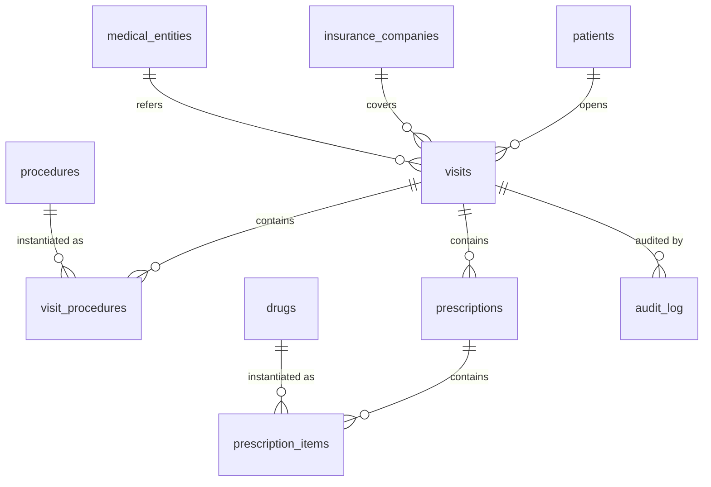

# مخطط العلاقات — Entity Relationship Diagram

> **الحالة:** مكتمل. يعتمد على قرارات D-001 إلى D-006 وقاموس البيانات المعتمد (11 جدولًا).

## المخطط

## جدول العلاقات

<table>
  <thead><tr><th>#</th><th>الجدول الأب</th><th>الجدول الابن</th><th>المفتاح الأجنبي في الابن</th><th>العلاقة والحذف</th><th>ملاحظات</th></tr></thead>
  <tbody>
    <tr><td>1</td><td>patients</td><td>visits</td><td>patient_id → patients.id</td><td>1 → N | RESTRICT</td><td>المريض يملك عدة إقامات؛ ربط المريض إلزامي.</td></tr>
    <tr><td>2</td><td>insurance_companies</td><td>visits</td><td>insurance_company_id → insurance_companies.id</td><td>1 → N | RESTRICT</td><td>الربط اختياري عمومًا، وإلزامي لعقد التأمين.</td></tr>
    <tr><td>3</td><td>medical_entities</td><td>visits</td><td>referred_entity_id → medical_entities.id</td><td>1 → N | RESTRICT</td><td>الجهة المحوّلة اختيارية، ويُحفظ اسمها كلقطة عند الربط.</td></tr>
    <tr><td>4</td><td>visits</td><td>visit_procedures</td><td>visit_id → visits.id</td><td>1 → N | RESTRICT</td><td>بنود الإجراءات داخل الإقامة.</td></tr>
    <tr><td>5</td><td>procedures</td><td>visit_procedures</td><td>procedure_id → procedures.id</td><td>1 → N | RESTRICT</td><td>كل بند يشير إلى إجراء مع لقطة الاسم والتصنيف والسعر.</td></tr>
    <tr><td>6</td><td>visits</td><td>prescriptions</td><td>visit_id → visits.id</td><td>1 → N | RESTRICT</td><td>الروشتة بند علاج مستقل داخل الإقامة.</td></tr>
    <tr><td>7</td><td>prescriptions</td><td>prescription_items</td><td>prescription_id → prescriptions.id</td><td>1 → N | RESTRICT</td><td>بنود الأدوية داخل الروشتة.</td></tr>
    <tr><td>8</td><td>drugs</td><td>prescription_items</td><td>drug_id → drugs.id</td><td>1 → N | RESTRICT</td><td>كل بند يشير إلى دواء مع لقطة الاسم والسعر.</td></tr>
    <tr><td>9</td><td>visits</td><td>audit_log</td><td>visit_id → visits.id</td><td>1 → N | RESTRICT</td><td>التصحيحات الإدارية مرتبطة بالإقامة.</td></tr>
  </tbody>
</table>

> يُظهر الجدول تسع علاقات بمفاتيح أجنبية. علامة N تعني إمكانية تعدد سجلات الابن، ولا تعني إلزامية وجود سجل ابن لكل أب.

## الجداول الجذرية

الجداول التي لا تحمل مفاتيح أجنبية إلى جداول أخرى هي:

- **patients:** أصل سجل المريض؛ ترتبط به الإقامات عبر `visits.patient_id`.
- **insurance_companies:** كتالوج شركات التأمين؛ قد تُربط الشركة بعدة إقامات.
- **medical_entities:** كتالوج الجهات المحوّلة؛ قد تُربط الجهة بعدة إقامات.
- **procedures:** كتالوج الإجراءات؛ تُستخدم عناصره في `visit_procedures`.
- **drugs:** كتالوج الأدوية؛ تُستخدم عناصره في `prescription_items`.
- **settings:** جدول مستقل للمفاتيح والقيم، ولا يحمل أي علاقة بمفتاح أجنبي.

`settings` غير مرسوم في مخطط Mermaid لأنه بلا علاقة مع الجداول الأخرى.

## Polymorphic — مرجع سجل التدقيق

يحفظ `audit_log` تصحيحات ما بعد الخروج (D-006). يرتبط السجل بالإقامة بمفتاح أجنبي صريح
`audit_log.visit_id → visits.id`، بينما يحدد زوج الحقلين `entity_type` و`entity_id`
الكيان المصحَّح بأسلوب polymorphic reference.

القيم المسموحة لـ `entity_type` هي:

- `visit` → سجل في `visits`.
- `visit_procedure` → سجل في `visit_procedures`.
- `prescription` → سجل في `prescriptions`.
- `prescription_item` → سجل في `prescription_items`.

لا يمثل `entity_id` مفتاحًا أجنبيًا عاديًا إلى أحد هذه الجداول الأربعة؛
الجدول المقصود يتغير حسب `entity_type`، لذا لا تُرسم أربع علاقات إضافية
في Mermaid ولا تُحتسب ضمن العلاقات التسع أعلاه.

يجب أن يفسر التطبيق النوع والمعرّف معًا عند عرض التصحيح أو التحقق منه؛
أما ربط السجل بالإقامة فيظل مضمونا بالمفتاح الأجنبي `visit_id`.

## لا CASCADE

جميع المفاتيح الأجنبية التاريخية التسعة تستخدم `ON DELETE RESTRICT`.
لا تستخدم العلاقات `ON DELETE CASCADE`؛ الحذف الفعلي لأب مرتبط بسجلات تاريخية
قد يفقد بيانات الإقامة أو الفواتير أو التدقيق.

- الكتالوجات والمرضى يُعطَّلون عبر `is_active = 0` بدل الحذف الفعلي.
- الإقامة لا تُحذف؛ تُغلق عبر `discharge_date`.
- بنود الإقامة والروشتة وسجل التدقيق لا تُحذف تاريخيًا؛ التصحيحات تُسجَّل في `audit_log`.
- اللقطات في البنود تحفظ الاسم والسعر وقت الاستخدام حتى بعد تعديل الكتالوج.

## prescriptions منفصل عن visit_procedures

`prescriptions` يمثل بند العلاج داخل الإقامة وفق D-005، لا إجراءً في
`visit_procedures`. لكل روشتة `visit_id` يشير إلى الإقامة، وتاريخ
`prescription_date` مستقل عن تاريخ الدخول.

تحتوي الروشتة على صفوف `prescription_items`، ويرتبط كل صف بدواء واحد من
`drugs`. أما `visit_procedures` فيحتوي الأشعة والتحاليل والإسعاف ويرتبط
بكتالوج `procedures` لا بكتالوج الأدوية.

ليس بين `prescriptions` و`visit_procedures` مفتاح أجنبي مباشر؛ كلاهما
يتبع `visits` عبر علاقة مستقلة. ويُحسب إجمالي العلاج من بنود الروشتة،
بينما تحفظ بنود الإجراءات أسعارها وكمياتها كلٌ على حدة.

## العلاقات كنص

1. مريض واحد يمكن أن تكون له عدة إقامات، وكل إقامة تتبع مريضًا واحدًا.
2. شركة تأمين واحدة قد تغطي عدة إقامات؛ رابط الشركة اختياري لغير عقود التأمين.
3. جهة طبية واحدة قد تحيل عدة إقامات؛ ويمكن أن تكون الإقامة بلا جهة محوّلة.
4. إقامة واحدة قد تحتوي عدة بنود إجراءات، وكل بند يتبع إقامة واحدة.
5. إجراء واحد من الكتالوج قد يظهر في عدة بنود إجراءات، وكل بند يرتبط بإجراء واحد.
6. إقامة واحدة قد تحتوي عدة روشتات، وكل روشتة تتبع إقامة واحدة.
7. روشتة واحدة قد تحتوي عدة بنود أدوية، وكل بند يتبع روشتة واحدة.
8. دواء واحد من الكتالوج قد يظهر في عدة بنود روشتات، وكل بند يرتبط بدواء واحد.
9. إقامة واحدة قد يكون لها عدة سجلات تدقيق، وكل سجل تدقيق يتبع إقامة واحدة.

هذه العلاقات تمثل المفاتيح الأجنبية التسعة في قاموس البيانات؛ لا توجد
علاقات إضافية لـ `settings` أو للمراجع متعددة الأنواع داخل `audit_log`.
